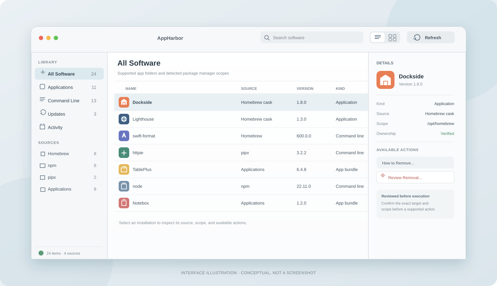

<p align="center">
  
</p>

<p align="center">
  <a href="https://github.com/BillyMRX1/AppHarbor/releases/download/v0.2.0/AppHarbor-0.2.0-arm64.dmg"><strong>Download AppHarbor 0.2.0 · Apple silicon</strong></a>
  &nbsp;·&nbsp; <a href="https://github.com/BillyMRX1/AppHarbor/releases">Releases</a>
  &nbsp;·&nbsp; <a href="LICENSE">MIT License</a>
</p>

AppHarbor brings supported Mac applications and package-manager installs into one local library. See where an item came from, inspect its scope, and review an available source-specific action before it runs.

<p align="center">
  
</p>
<p align="center"><sub>Interface illustration. The example names and counts are conceptual, not an application screenshot.</sub></p>

## What it does

- Organizes supported application folders and detected Homebrew, npm, pipx, and Cargo installations in a searchable library.
- Shows source, scope, version, kind, and ownership details where the source reports them.
- Lets you view the library as a sortable list or a selectable grid, with the same contextual actions in either view.
- Reviews the exact target and proposed effects before a supported manager action, then checks the owning scope again afterward.
- Keeps inventory and activity data on your Mac. AppHarbor does not need root access or Full Disk Access.

AppHarbor checks supported locations and detected manager scopes; it does not claim to find every executable or application on the Mac. The Sources and Settings views explain what was detected and which application folders are included.

## MCP and AI clients

AppHarbor includes an optional local MCP bridge for compatible AI clients. The bridge and AI action requests are separate settings, and both are off by default. Settings can copy a generic client configuration for the installed app; AppHarbor does not edit a client configuration automatically. Keep AppHarbor open while a connected client uses it. See [MCP setup and tool details](Docs/MCP.md).

The connected client can receive installed software names, versions, and source paths, and its provider may forward that context to a model service. AI action requests are limited to supported removal and update reviews. AppHarbor shows the exact target in its native interface, and a person must confirm there before execution. The bridge does not provide arbitrary shell commands, filesystem access, batch uninstall, junk cleanup, or root operations.

## Download and install

Download the Apple silicon disk image from the [AppHarbor 0.2.0 release](https://github.com/BillyMRX1/AppHarbor/releases/tag/v0.2.0). Open `AppHarbor-0.2.0-arm64.dmg`, then drag **AppHarbor.app** to **Applications**. Open it from Applications.

This preview is ad-hoc signed and not notarized. If macOS blocks launch, see [Apple’s instructions for apps from an unknown developer](https://support.apple.com/guide/mac-help/open-a-mac-app-from-an-unknown-developer-mh40616/mac).

## Action coverage

Capabilities vary by detected manager version, installation, and scope. AppHarbor only runs an operation when it can prepare a verified, source-specific plan for that item. You review the target and command, then confirm explicitly; AppHarbor re-checks the target before execution and verifies the result by refreshing that scope.

| Source or action | Current behavior |
| --- | --- |
| Homebrew | Inventories supported installations and offers verified removal or update actions where the selected package and scope qualify. Update checks use Homebrew’s local catalog with auto-update disabled, so an “Up to Date” result may reflect a catalog that is behind the remote registry. |
| npm | Checks and applies updates only when the exact public npm registry source is verified. Other cases show guidance. |
| pipx | Can report an update candidate; applying pipx updates remains manual guidance because saved install options and source details cannot yet be constrained to the reviewed candidate. |
| Cargo | Inventories explicitly selected install roots. Update checks and updates are guidance-only. |
| App bundles | Shows local app details and removal guidance. App-bundle removal and update checks are guidance-only. |

Update checks are explicit and run per installation. They do not run automatically.

## Build from source

**Requirements:** macOS 14 or later, an Apple silicon Mac, and Xcode with Swift 6.2 or later.

```sh
Scripts/build-app.sh
Scripts/run-app.sh
Scripts/smoke-app.sh
```

The app bundle is created at `dist/AppHarbor.app`. The build signs it locally with an ad-hoc signature and does not need Developer ID credentials. The current release build targets Apple silicon. Intel support has not been verified.
The bundled `Contents/Resources/ThirdPartyNotices.txt` contains license texts for the resolved Swift package dependencies.

To create the release disk image after building:

```sh
Scripts/package-dmg.sh
```

This writes `dist/AppHarbor-0.2.0-arm64.dmg` and includes the drag-to-Applications instructions. Public distribution with a Developer ID signature and notarization is still pending.

## Local data and uninstall

The normalized inventory cache and redacted activity history are stored at `~/Library/Application Support/AppHarbor/state.json`. Settings are stored in the `com.appharbor.desktop` user defaults domain. Moving the app to the Trash does not remove this data.

To remove AppHarbor’s saved data too, quit the app and delete the `AppHarbor` folder under `~/Library/Application Support` and the `com.appharbor.desktop` preferences file under `~/Library/Preferences`. This does not remove software AppHarbor inventoried; manage that software through its own source-specific review or instructions.

## License

AppHarbor is available under the [MIT License](LICENSE).
